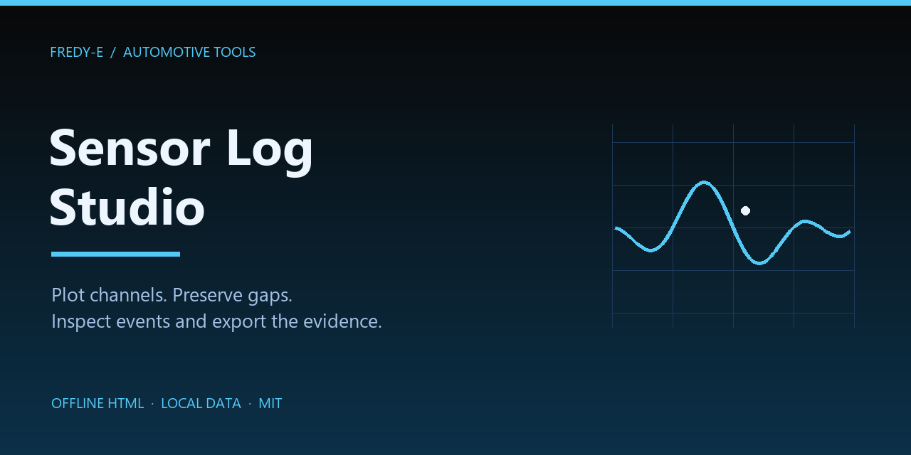
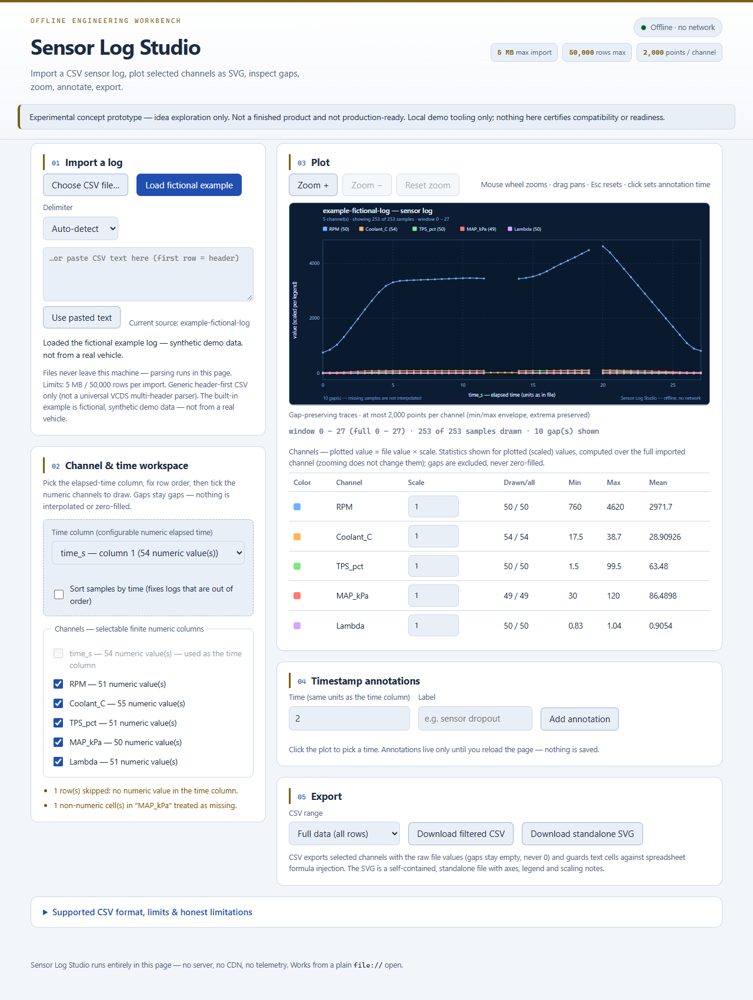

# Sensor Log Studio

<!-- prototype-status:start -->
> **Experimental concept prototype — idea exploration only.**
> A work-in-progress demo, not a finished or production-ready product. Existing features and tests demonstrate the concept; they do not establish real-world reliability or complete functionality. Features may change or remain unfinished.
<!-- prototype-status:end -->



Development and CI: [verification instructions](docs/verification.md).

An **offline, single-page CSV sensor-log viewer**. Open `index.html` in a browser and it
parses, plots and exports — no server, no build step, no CDN, no runtime package dependencies,
telemetry, or data uploads. A disk-opened copy works without network access. If hosted,
your browser downloads this app's HTML/CSS/JavaScript files from the host; imported logs stay local.

> Status: experimental concept prototype, not a production release. Licensed under [MIT](LICENSE). Browser runtime has no package dependencies.

## Screenshot



## Run it

- **Browser:** double-click `index.html` (works from a plain `file://` open), or serve the
  folder with any static file server if you prefer.
- **Tests:** `npm test` (Node ≥ 22; developed on Node 26) runs the core unit suite.
  `npm run test:browser` runs the real-browser end-to-end checks (needs Playwright + Chrome);
  `node --test tests/mobile-overflow.test.cjs` is the mobile-layout regression.

Files:

| File | Purpose |
| --- | --- |
| `index.html` | Page shell; loads `style.css`, `core.js`, `app.js` as classic scripts |
| `core.js` | Pure, dependency-free logic: parsing, dataset, stats, downsampling, SVG + CSV generation. Exposes `window.SensorLog` in the browser and `module.exports` in Node |
| `app.js` | Browser UI glue (import, mapping, plot, zoom/pan, annotations, downloads) |
| `style.css` | Dark blue engineering theme, responsive, accessible focus states |
| `tests/core.test.cjs` | Node unit tests for `core.js` (written before the implementation — see *Testing*) |
| `tests/mobile-overflow.test.cjs` | Real-browser mobile regression test: page body must not overflow at 390 px / 320 px (Playwright; skips when unavailable) |
| `tests/browser.cjs` | Real-browser end-to-end suite (`npm run test:browser`): import → annotate → export flow, offline and console-error checks, mobile widths; writes evidence to ignored `test-results/` |
| `reports/` | Local test-run logs (deliberately git-ignored, never committed) |

## Features

- **Import:** file picker or pasted text; comma / semicolon / tab delimiter with
  auto-detection; quoted fields with `""` escapes, embedded newlines, BOM, CRLF/CR/LF.
- **Column mapping:** configurable numeric elapsed-time column (auto-suggested); channels
  are the *selectable finite numeric columns*; per-column numeric counts shown.
- **Plot:** SVG line chart with explicit axis titles (time column name + units note) and a
  legend stating each channel's color, display scale and drawn sample count.
- **Statistics:** per-channel min / max / mean / sample counts in the legend table,
  computed over the full imported channel (zooming does not change them).
- **Zoom / range:** `Zoom +` / `Zoom −` / `Reset`, mouse-wheel zoom (cursor-anchored), drag
  to pan, `Esc` to reset; current window readout under the plot.
- **Timestamp annotations:** add labeled vertical markers at any time value; click the plot
  to pick a time; remove individually.
- **Exports:** filtered CSV (selected channels, full data or current zoom window) and a
  standalone SVG with everything baked in. Both are generated locally via Blob URLs.
- **Fictional example:** a clearly-labeled synthetic demo log is built in for first-run
  exploration. It is not from a real vehicle and is never mixed with your files.

## Supported CSV format (documented contract)

- First non-blank line is the header row; data rows follow. One row = one sample set.
- Delimiters: `,`, `;` or tab (auto-detected from the first lines, or choose manually).
- Fields may be quoted with `"`; `""` inside a quoted field is an escaped quote; quoted
  fields may contain newlines.
- UTF-8 with or without BOM; CRLF, LF or CR line endings.
- Numbers: plain decimal or exponent notation with optional sign (`-1.5`, `.5`, `2.5e3`).
  No unit suffixes, no thousands separators (`1,5` or `5 mV` are *not* numbers).
- The time column must be finite numeric. Cells that are empty, blank, or not parseable
  are treated as **missing** — they are never coerced to `0` and never interpolated.

### Hard limits (visible rejection messages)

- **5 MB** and **50,000 data rows** per import.
- A row with **more fields than the header** (after ignoring trailing empty fields) is
  rejected with its line number — a likely delimiter/quoting problem.
- Rows with fewer fields are tolerated; missing trailing cells are treated as empty.
- An unterminated quoted field rejects the file with the approximate line.

### Data handling rules

- Rows whose time cell is not a finite number are **skipped with a warning** and break the
  drawn trace (no sample is fabricated at an unknown time).
- Missing channel values create **gaps**: the line is broken, and `No interpolation` is
  stated in the plot footer.
- Out-of-order timestamps are detected (`inversions`) and reported. By default the file
  order is preserved; tick **“Sort samples by time”** to reorder (stable sort).
- Plots are bounded: at most **2,000 points per channel** are drawn *across all visible
  segments*. Dense stretches use a per-segment min/max envelope; when gaps split a channel
  into more segments than the budget, evenly spread representative samples are drawn
  instead. Global extrema survive, gaps are never bridged, and the plot never creates
  tens of thousands of SVG nodes.
- Statistics and exports use **raw file values**; the per-channel **scale field is a
  display-only multiplier** (e.g. `0.001` to show ADC counts as volts). The legend table
  shows min / max / mean of the *scaled* plotted values over the full imported channel and
  says so; only the drawn/available counts describe the visible range.

## Export notes

- **CSV:** delimiter `,`, CRLF newlines, raw values, gaps as empty cells. Text cells are
  prefixed with `'` when they begin with `=`, `+`, `@`, a tab or a carriage return — or with
  `-` unless the cell is a plain number — to prevent formula injection on import into
  Excel/LibreOffice.
- **SVG:** standalone file (`viewBox`, background, axes, legend, scaling notes, gap note);
  all user-derived strings are XML-escaped.

## DOM selectors (for QA automation)

Each interactive element has a stable `id` and a matching `data-testid`:

| Selector (`#id` / `[data-testid]`) | Element |
| --- | --- |
| `#file-input` | hidden file input (`accept=".csv,.txt"`) |
| `#btn-load-example` | load the fictional example log |
| `#delimiter-select` | delimiter override (`""` = auto) |
| `#paste-input`, `#btn-load-paste` | paste import |
| `#status-line` (`role="status"`), `#error-line` (`role="alert"`) | messages |
| `#source-name` | current source name |
| `#mapping-panel`, `#time-column`, `#sort-by-time`, `#channel-list`, `#parse-notes` | column mapping |
| `#plot-panel`, `#plot` (plot host), `#meta-line`, `#legend-body` | plot region |
| `#btn-zoom-in`, `#btn-zoom-out`, `#btn-zoom-reset` | zoom/range controls |
| `#annot-panel`, `#annotation-time`, `#annotation-label`, `#btn-add-annotation`, `#annotation-error`, `#annotation-list` | annotations |
| `#export-panel`, `#range-mode`, `#btn-download-csv`, `#btn-download-svg` | exports |

The rendered plot is `#plot > svg` (with `role="img"`, `<title>`, `<desc>`); series paths
are `<path>` elements.

## Core API (`window.SensorLog` / `require('./core.js')`)

`parseNumber`, `detectDelimiter`, `parseCSV`, `classifyColumns`, `suggestTimeColumn`,
`buildDataset`, `computeStats`, `fullWindow`, `clampWindow`, `zoomWindow`, `panWindow`,
`niceTicks`, `makeScale`, `downsamplePoints`, `buildPlotModel`, `svgLayout`,
`renderSVGString`, `exportCSV`, `guardFormula`, `escapeXML`, `formatNumber`, `formatBytes`,
`truncate`, `sanitizeFilename`, plus constants `LIMITS`, `PALETTE`, `DELIMITERS`,
`DELIMITER_NAMES`, `EXAMPLE_CSV`, `VERSION`.

Fallible calls return `{ ok: true, value }` or `{ ok: false, error: { code, message } }`.

## Testing

The 47 core tests cover parsing (delimiters, quotes, newlines, BOM/CRLF, ragged rows,
quoted-empty and EOF-quote variants, explicit tab overrides, size/row limits), time
validation and ordering (including sort-by-time keeping the trace breaks after skipped
rows), missing-value gap semantics, statistics, tick/step math, zoom/pan windows,
annotation window-edge behaviour, downsampling bounds and extrema, the strict
per-channel point budget on dense and gap-heavy 50k-row logs (alternating gaps,
four-on/one-off, multiple dense segments, custom budgets, SVG node counts), plot-model
construction and its failure paths, CSV export guarding and SVG string escaping
(including XML-invalid noncharacters). The original 30 were written
**before** the implementation (TDD): the first run failed with
`Cannot find module '../core.js'` (recorded in `reports/test-run-initial-fail.txt`), then
the implementation was added until the suite passed cleanly
(`reports/test-run-final-pass.txt`). The six budget regression tests were added after an
independent spec review found the old per-bucket envelope could exceed 2,000 drawn points
on gap-heavy logs.

```bash
npm test
npm run test:browser   # needs Playwright + Chrome (see docs/verification.md)
```

A real-browser mobile regression test (`tests/mobile-overflow.test.cjs`) drives the
import → annotation flow and asserts the page body never scrolls sideways (≤ 1 px)
at 390 px and 320 px viewports, while the plot and legend table keep their own
contained horizontal scroll. It runs when Playwright and a usable browser are available
(app-local, or the shared `qa/` runner's `node_modules`; installed Chrome on Windows,
bundled Chromium elsewhere or as a fallback) and skips cleanly otherwise.

`npm run test:browser` (`tests/browser.cjs`) drives the full import → annotate → export
workflow plus the keyboard-focus and export-guard regressions in a real browser, fails
on page/console errors or unexpected network requests, and writes its evidence to the
ignored `test-results/` directory.

## Honest limitations

- **Generic CSV importer only.** This is *not* a universal VCDS multi-header parser and
  does not understand block headers, unit rows, metadata sections, or vendor logs with
  several tables in one file. Pre-process those into one header-first table.
- One time column per file; numeric elapsed time only (no dates, timezones or wall clocks).
- No unit conversion; the scale field is display-only and does not change data or exports.
- The whole file is read into memory (bounded by the 5 MB / 50k rows limits).
- Floating-point parsing follows JavaScript `Number` semantics.
- Downsampled plots are representative, not complete: dense stretches show a min/max
  envelope and gap-heavy logs show evenly spread representative samples — individual
  samples between drawn points are not all drawn (exact data remains in the CSV export).
- Annotations are ephemeral (reload clears them) and not persisted, by design.
- Min / max / mean in the legend are computed over the **full imported channel** (every
  parsed sample), not just the visible zoom window; only the drawn/available sample
  counts describe the current range. The CSV export always uses the raw values.
- Modern evergreen browsers only (Chromium/Firefox/Safari current versions).

## Privacy

No storage, no cookies, no network requests, no telemetry. Files are read locally via the
File API; exports are generated locally as Blob downloads.

## Verify (default)

Full default verification (unit + browser + mobile layout + preview-shell UI regression):

```sh
npm run verify
# = node --test tests/core.test.cjs && node tests/browser.cjs && node --test tests/mobile-overflow.test.cjs && node --test tests/preview-shell.test.cjs
```

`npm test` runs the core unit subset only. Browser suites need Playwright 1.63.0 (dev-only) plus Chrome/Chromium.
